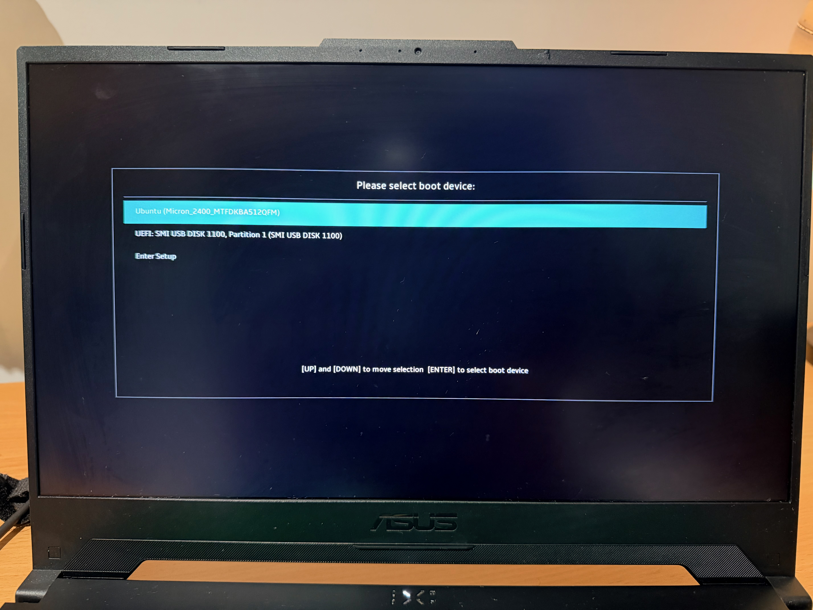
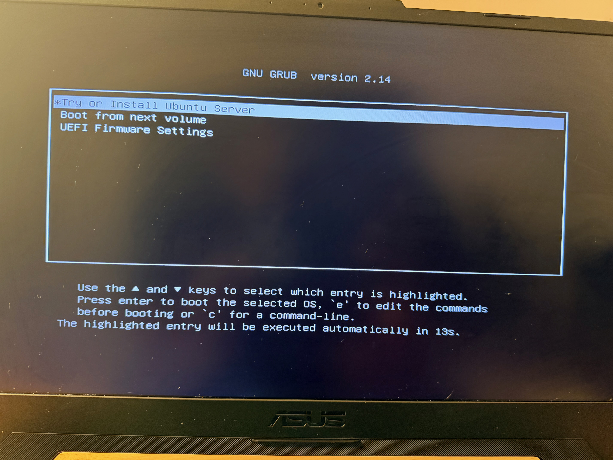
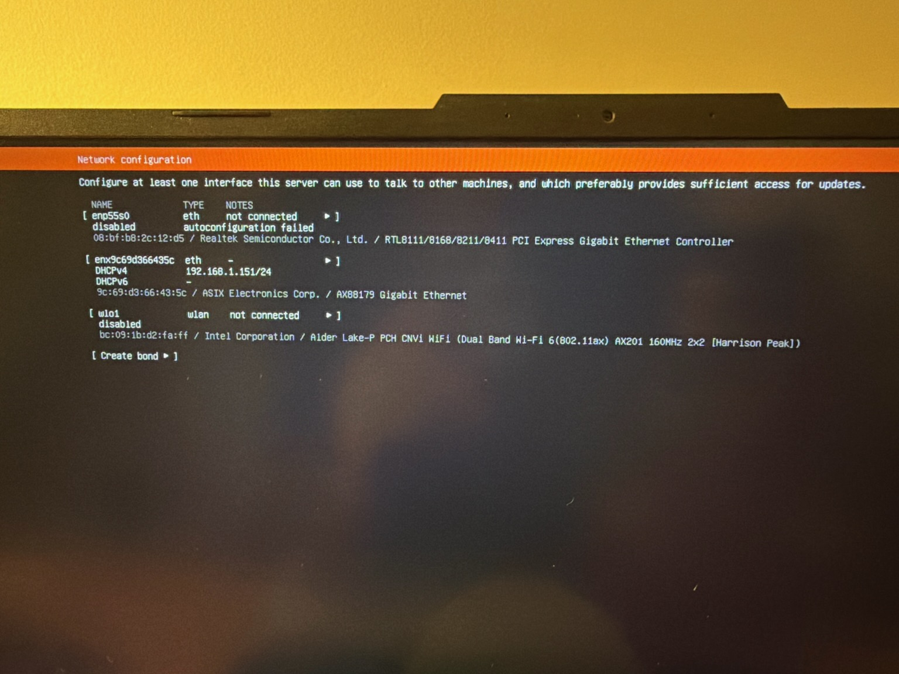
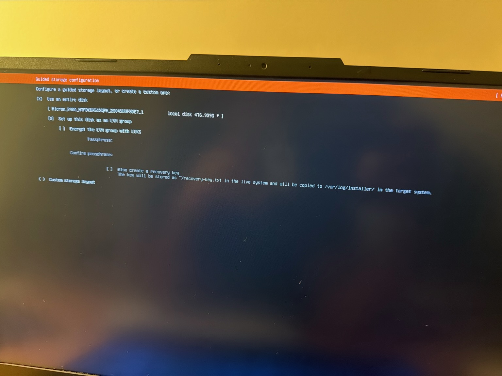
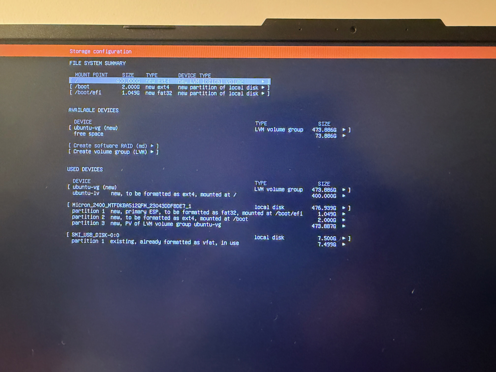
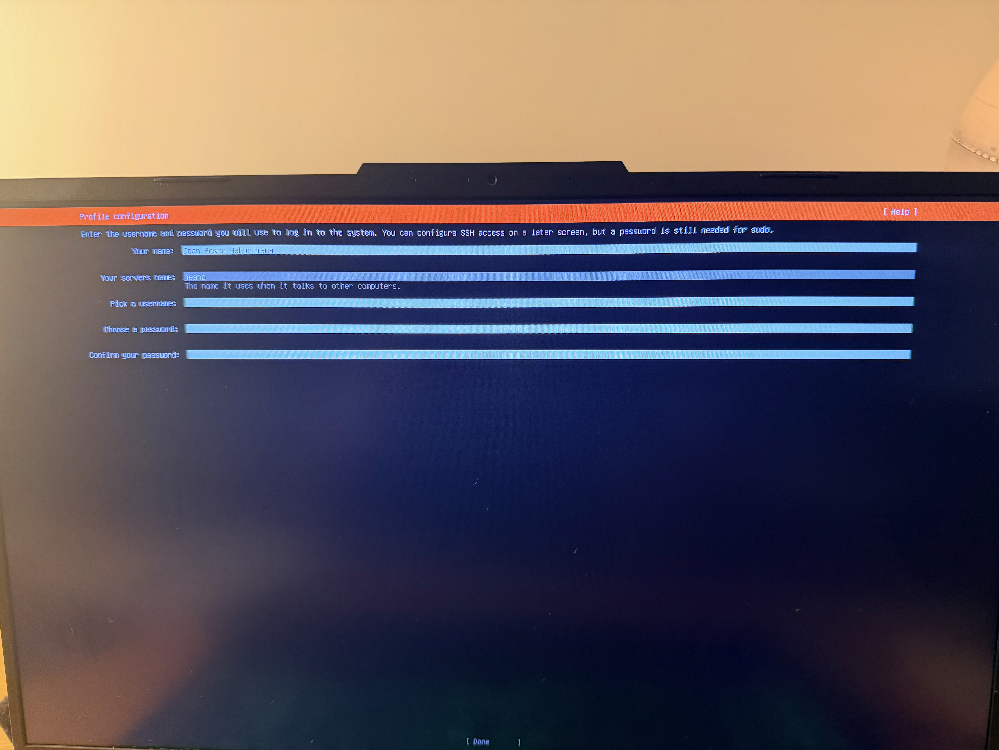
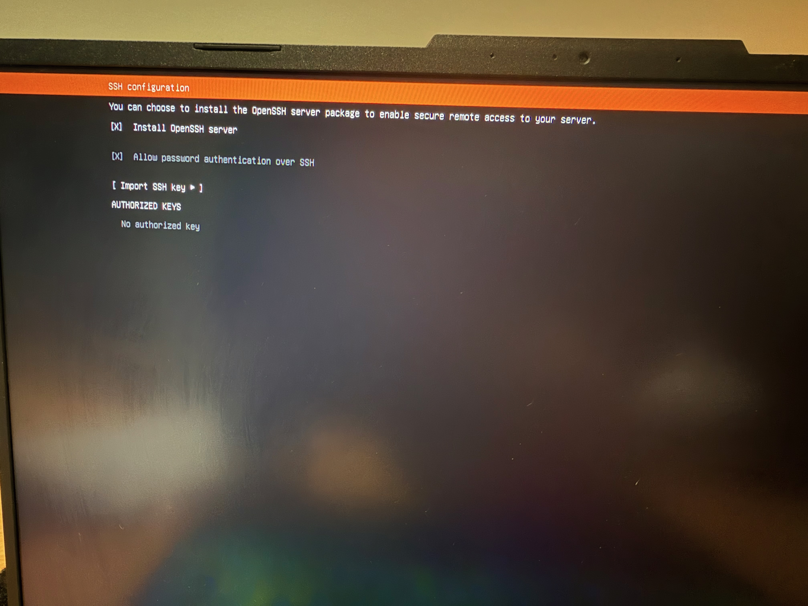
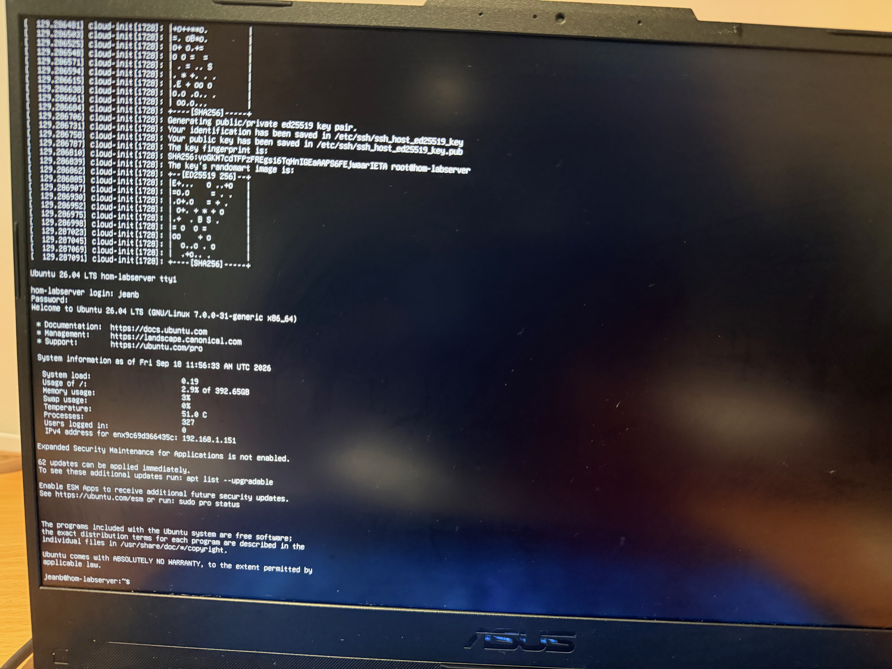

# Wazuh SIEM Homelab

## Project Overview

This project documents the deployment of a Wazuh SIEM homelab environment built on a dedicated Ubuntu Server.

The purpose of the project is to gain hands-on experience with Linux server administration, SIEM deployment, endpoint monitoring, log collection, security event detection, and custom Wazuh rules.

The environment is being documented step-by-step as a cybersecurity portfolio project.

## Project Objectives

- Deploy Ubuntu Server on dedicated hardware
- Configure remote administration using SSH
- Install and configure Wazuh
- Deploy Wazuh agents to monitored endpoints
- Collect and analyse security logs
- Generate and investigate security events
- Develop custom Wazuh detection rules
- Integrate UniFi network events with Wazuh
- Document troubleshooting and testing

## Lab Environment

| Component | Purpose |
|---|---|
| ASUS Laptop | Dedicated Ubuntu Server |
| Ubuntu Server | Wazuh host operating system |
| Wazuh | SIEM / XDR platform |
| MacBook | Remote administration and documentation |
| UniFi Network | Network monitoring and log source |
| Windows / Linux endpoints | Wazuh agent monitoring |

---

# Phase 1 - Ubuntu Server Deployment

The first phase involved rebuilding the ASUS laptop as a dedicated Ubuntu Server.

The Ubuntu installation media was loaded onto a bootable USB drive and the server was configured from a clean installation.

## Boot Device Selection

The ASUS boot menu was used to select the Ubuntu Server installation USB.

## Ubuntu Server Installer

The system was booted into the Ubuntu Server installer through the GNU GRUB menu.

## Network Configuration

The server initially obtained its network configuration using DHCP.

## Storage Configuration

Guided storage using LVM was selected during installation.

The root logical volume was then configured for the server.

## Server Profile

A local administrator account and server hostname were configured.

## OpenSSH Configuration

OpenSSH Server was enabled to allow secure remote administration of the server.

## First Local Login

After installation and reboot, the Ubuntu Server successfully reached the local login prompt.

---

# Phase 2 - Server Configuration

Coming next:

- Verify operating system and network configuration
- Update Ubuntu packages
- Configure SSH administration
- Review firewall configuration
- Prepare the server for Wazuh deployment

---

# Phase 3 - Wazuh Deployment

To be documented.

# Phase 4 - Agent Deployment

To be documented.

# Phase 5 - Security Monitoring and Testing

To be documented.

# Phase 6 - Custom Detection Rules

To be documented.

---

## Skills Demonstrated

Linux administration, SSH, networking, Wazuh SIEM, endpoint monitoring, log analysis, security event detection, incident investigation, Docker, UniFi integration, troubleshooting, and technical documentation.

## Disclaimer

This project was created in a controlled homelab environment for educational and cybersecurity training purposes.
